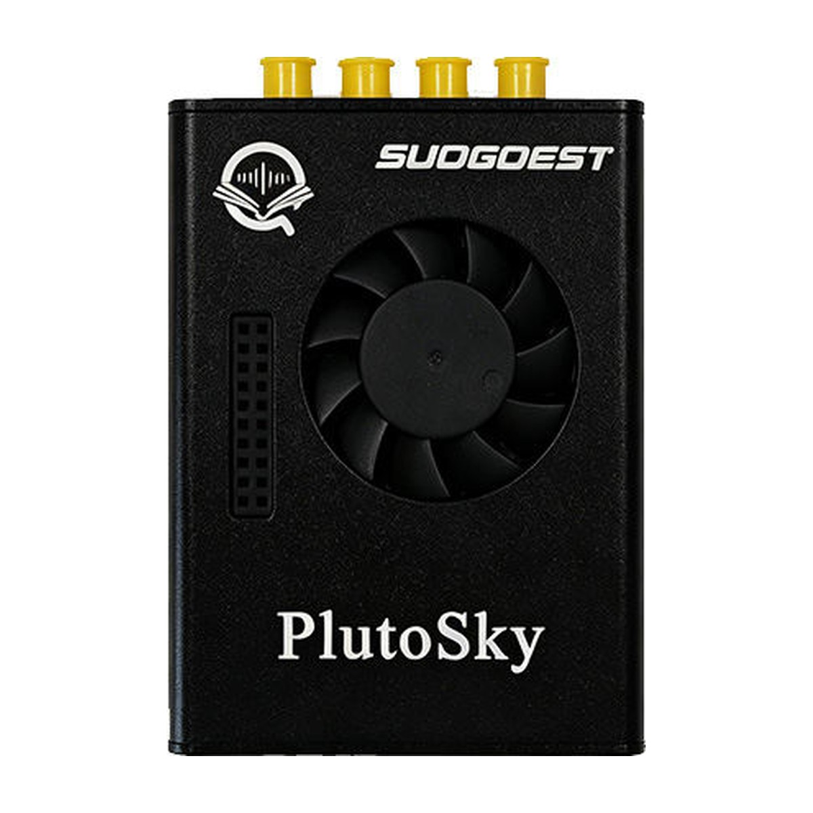
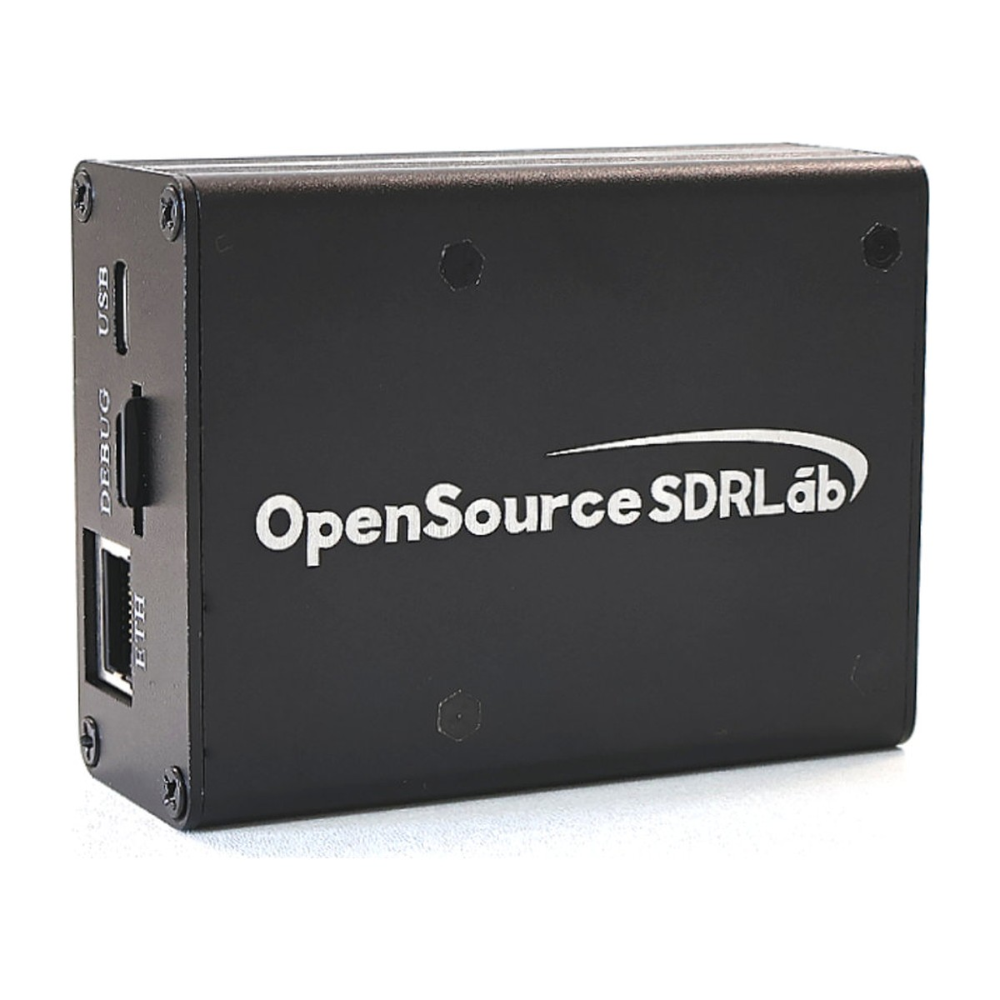

# PlutoSky_7020_AD936X_SDR

Hardware files, firmware and documentation for the **OpenSourceSDRLab PlutoSky 7020 AD936X SDR** ("New PlutoSky"), a PlutoSDR-compatible software-defined radio with a Zynq-7020, an AD9361 transceiver, transmit amplifiers and Gigabit Ethernet.

  
  

## Product link

<https://opensourcesdrlab.com/products/opensourcesdrlab-new-plutosky>

## About the board

- RF transceiver: Analog Devices **AD9361** (2 transmit, 2 receive, 70 MHz–6 GHz, up to 56 MHz bandwidth); TX1/RX1/TX2/RX2 on SMA connectors
- Transmit amplifiers (PGA-102+) on both TX outputs; a PA-bypass assembly variant exists (see `hardware/`)
- SoC: Xilinx Zynq **XC7Z020-CLG400**, 1 GB DDR3, 16 MB QSPI flash, microSD slot
- Interfaces: **Gigabit Ethernet**, USB-C **OTG** (USB 2.0), USB-C **DEBUG** (JTAG + UART, power), GPIO expansion header, external LO and reference clock inputs
- Firmware: port of the Analog Devices PlutoSDR firmware v0.38; works with libiio, IIO Oscilloscope, GNU Radio, MATLAB and other PlutoSDR software
- Aluminium enclosure with fan; CAD files in `3D case/`

## Quick start

1. Download `PlutoSky-7020_SD-card-firmware_v0.38.zip` from the [Releases](../../releases) page and copy its files to a FAT32 microSD card.
2. Set the boot switch to SD boot, insert the card and connect the **OTG** port (USB) or the Ethernet port.
3. Over USB the board is `192.168.2.1`; check with `iio_info -u ip:192.168.2.1`.

The full steps are in the **[Quick Start Guide](docs/Quick-Start-Guide.md)** ([PDF](docs/Quick-Start-Guide.pdf)).

## Repository layout

| Path | Contents |
|---|---|
| `hardware/` | Schematics: current revision with PA, PA-bypass variant, and the earlier 2025-05 revision (PDF) |
| `firmware/` | Where to get the prebuilt firmware; `firmware/source/` has the firmware source changes |
| `3D case/` | Enclosure CAD files (STEP, DWG) |
| `docs/` | Quick Start Guide (Markdown and PDF) |
| `images/` | Product photos |

## Downloads (Releases)

Large files are attached to the [Releases](../../releases) page instead of being stored in the repository:

| File | Contents |
|---|---|
| `PlutoSky-7020_SD-card-firmware_v0.38.zip` | SD-card boot files (PlutoSDR firmware v0.38 port) |
| `PlutoSky-7020_QSPI-flash-firmware_v0.38.zip` | QSPI flash firmware and DFU script |
| `PlutoSky-7020_SD-card-firmware_v0.38-no-tuning.zip`, `PlutoSky-7020_QSPI-flash-firmware_v0.38-no-tuning.zip` | The same firmware for boards that report `tuning failed` |
| `SHA256SUMS.txt` | SHA-256 checksums of the files above |

Check a download with `shasum -a 256 -c SHA256SUMS.txt` (macOS / Linux) or `certutil -hashfile <file> SHA256` (Windows).

## Licence

Files created by OpenSourceSDRLab are released under the [Apache License 2.0](LICENSE). The firmware is built from Analog Devices PlutoSDR firmware, Linux, U-Boot and buildroot and remains under their own licences (mostly GPL); see [NOTICE.md](NOTICE.md).

## Support

- Email: support@opensourcesdrlab.com
- Forum: <https://forum.opensourcesdrlab.com>
- Discord: <https://discord.gg/nnxY6DkmvT>
- Blog and user manuals: <https://blog.opensourcesdrlab.com>

---
© 2026 OpenSourceSDRLab. All rights reserved. · <a href="https://www.opensourcesdrlab.com">www.opensourcesdrlab.com</a>
